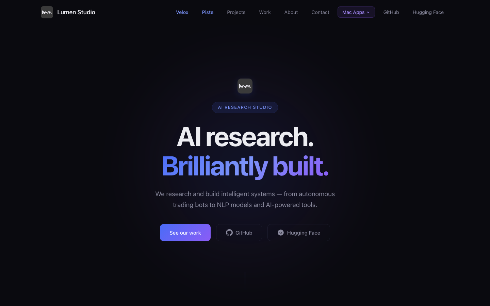
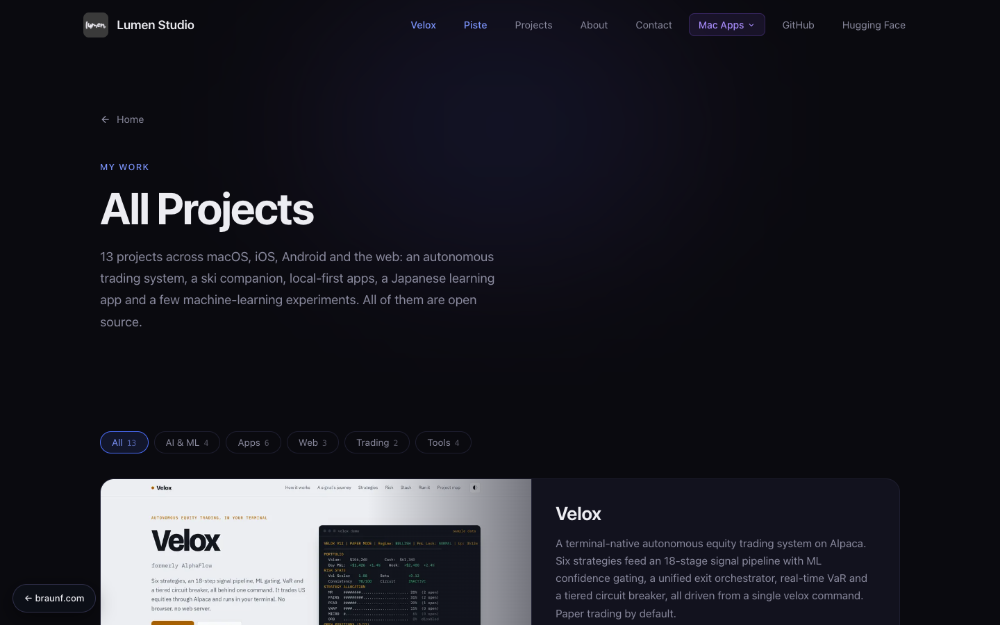
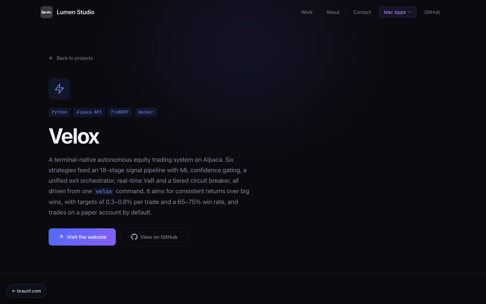

<div align="center">


# Lumen Studio

**AI research. Brilliantly built.**

The website for Lumen Studio, my personal projects portfolio: intelligent systems, from autonomous trading to NLP models and AI-powered tools.

[](https://projects.braunf.com)
[](LICENSE)
[](https://pages.github.com)


</div>

## Preview

| Home | Projects |
| --- | --- |
|  |  |
| **Velox** | |
|  | |

## Overview

A fast, dependency-free static site written in plain HTML, CSS and JavaScript. There is no framework, bundler or build step.

| Page | Description |
| --- | --- |
| [`index.html`](index.html) | Landing page: hero, featured project (Velox), a selection of projects, about and contact |
| [`projects.html`](projects.html) | All 7 projects with live thumbnails, a category filter and links to each site and repository |
| [`velox.html`](velox.html) | Velox, the autonomous trading system |
| [`silkworm.html`](silkworm.html) | Project Silkworm, the self-growing DPO dataset |

## Features

- Responsive layout: the nav (with Mac Apps and Web Apps dropdowns) collapses into a slide-out menu below 1280px, with focus states, `aria-expanded` and Escape-to-close
- Project cards with real website thumbnails, a cursor-following spotlight and status chips
- Scroll-triggered fade-in animations and a sticky, blurred nav bar
- Open Graph and Twitter Card metadata with canonical URLs for clean link previews
- Custom `404` page, `robots.txt` and `sitemap.xml`
- Zero dependencies and zero build tooling

## Getting started

```bash
git clone https://github.com/lumenworksco/Lumen-Studio.git
cd Lumen-Studio

# Open directly...
open index.html

# ...or serve locally
python3 -m http.server 8000   # http://localhost:8000
```

## Project structure

```
.
├── index.html        # Landing page
├── projects.html     # All projects
├── velox.html        # Velox product page
├── silkworm.html     # Project Silkworm page
├── 404.html          # Not-found page
├── style.css         # Shared styles
├── script.js         # Nav, menu and scroll animations
├── assets/           # Logo, banner, social preview and README screenshots
├── CNAME             # Custom domain for GitHub Pages
├── robots.txt
└── sitemap.xml
```

## Deployment

The site is served by GitHub Pages from the `main` branch at [projects.braunf.com](https://projects.braunf.com). The custom domain is set in [`CNAME`](CNAME), and `.nojekyll` disables Jekyll processing. Pushing to `main` deploys the site.

## Contact

- Email: [contact@braunf.com](mailto:contact@braunf.com)
- GitHub: [@lumenworksco](https://github.com/lumenworksco)
- Hugging Face: [iPwnds](https://huggingface.co/iPwnds)

## License

Released under the [MIT License](LICENSE) © 2026 Florian Braun.
